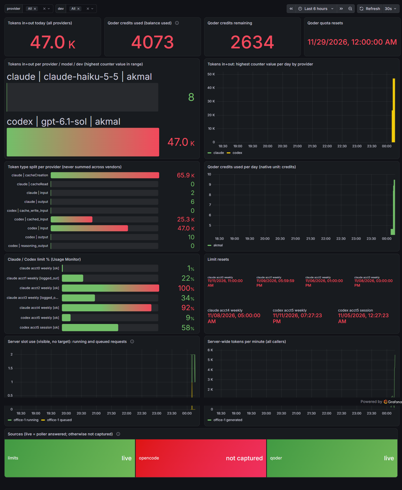

# Usage stack (OTel, Prometheus, Grafana)

> **TL;DR** — `deploy/usage/` runs a collector, Prometheus and Grafana in Docker. Claude Code, Codex and Qwen Code send counts by OTLP; two host pollers add Qoder credits, OpenCode tokens and the Claude/Codex limit %. Everyone sees everyone. No prompt text is stored.



## Start it

```
cd deploy/usage
cp .env.template .env                              # set GRAFANA_ADMIN_PW and HUB_DEV_DEFAULT
cp targets/targets.yml.template targets/targets.yml  # real SGLang / llama-server hosts (git-ignored)
docker compose up -d                               # Grafana http://127.0.0.1:3000, OTLP 4317 (grpc) / 4318 (http)
```

Network `agenthub-usage-net` is `10.78.0.0/24` (explicit, so Docker never takes a LAN range). Names are `agenthub-usage-*`. Stop with `docker compose down` (add `-v` to delete the data). Never `docker prune`.

## What goes where

| Source | Path in | Metric |
| --- | --- | --- |
| Claude Code | OTLP, env block in `config/` templates | `claude_code_token_usage_tokens_total` |
| Codex | OTLP http, `[otel]` / `-c otel.*` | `codex_turn_token_usage_sum` |
| Qwen Code | OTLP, metrics only, `logPrompts=false` | `qwen_code_token_usage_total` |
| OpenCode | `opencode_export.py` (piece A) via the host pollers | `opencode_tokens_total` |
| Qoder | `qoder_poll.py` (piece A) via the host pollers | `credits_used`, `credits_remaining`, `credits_used_today`, `credits_reset_timestamp_seconds` |
| Claude / Codex limit % | Usage Monitor, `pollers.py` | `usage_limit_percent`, `usage_limit_reset_timestamp_seconds` |
| Office SGLang, laptop llama-server | Prometheus scrape of `/metrics` | `sglang:*`, `llamacpp:*` (server-wide, no per-dev split) |

`rules.yml` joins the token sources into `hub_tokens_total{provider,model,dev,type}`. Token types stay split (vendors count cache differently); never read one summed number across vendors.

## Privacy

- The collector has a metrics pipeline only. Logs and traces are dropped on arrival (Qwen Code subagent results can paraphrase a prompt).
- Allow-list: the three token/cost metric families. Identity attributes (`user.email`, `user.id`, `user.account_*`, `organization.id`, `session.id`, `conversation.id`, `host.name`) are deleted. The client sets `dev` with `OTEL_RESOURCE_ATTRIBUTES=dev=<name>`; the collector fills `HUB_DEV_DEFAULT` when it is missing.
- Pollers read credentials from the environment only. `email` and config paths from the Usage Monitor are never exported.
- OTLP has no auth: bind it to the LAN only (`HUB_BIND=0.0.0.0` on a trusted network). Grafana serves anonymous viewers (decision 45); admin needs the password.

## Host pollers

`deploy/usage/pollers/pollers.py` serves one text endpoint on `:9109`; Prometheus scrapes `host.docker.internal:9109`.

```
# PowerShell                                  # sh
$env:USAGE_MONITOR_USER='...'                 export USAGE_MONITOR_USER=... USAGE_MONITOR_PASS=...
$env:USAGE_MONITOR_PASS='...'                 deploy/usage/pollers/run-pollers.sh
deploy/usage/pollers/run-pollers.ps1 -Dev <name>
```

- `limits` is implemented here. `qoder` and `opencode` run piece A's scripts from `plugins/usage-otel/pollers/` (`qoder_poll.py`, `opencode_export.py`); override the folder with `AGENT_HUB_POLLER_DIR`. There is no second copy.
- Qoder needs `pip install qoder-agent-sdk` and a `qodercli` login; per-day credits need `AGENT_HUB_QCREDITS_CMD`. Reset date comes from the SDK `expiresAt`.
- Each poller refreshes on its own timer and the endpoint serves the cache, so a slow CLI never makes Prometheus time out. `hub_poller_up{poller}` is 0 when a source failed; the dashboard shows it as "not captured".
- A container variant of the limit poller exists: `docker compose --profile pollers up -d`.

## Dashboard

`grafana/dashboards/usage.json`, provisioned. Panels: tokens per day, model, provider and dev; token type split; Qoder credits used, remaining, per day and reset date; Claude/Codex limit % and reset times; server slot use (running and queued requests, visible only, no target, decision 50); server-wide token rate; source health. Variables `provider` and `dev`.

After editing the dashboard file on a Windows bind mount, restart the Grafana container so it re-reads it.

## Known limits

- The "per day" panel shows the highest counter value reached per day, not a delta: a collector counter that first appears with a value gives `increase()` no baseline. Per-task deltas come from the usage plugin (W9).
- Per-dev counts for office Qwen come from the calling CLI; SGLang counters have no user label.
- Qoder tokens are not reported (credits only).
- `opencode_export.py` exits 1 when `opencode session list` prints nothing (project with no sessions, or run from a folder OpenCode does not know). Piece A should treat an empty list as zero tokens.
