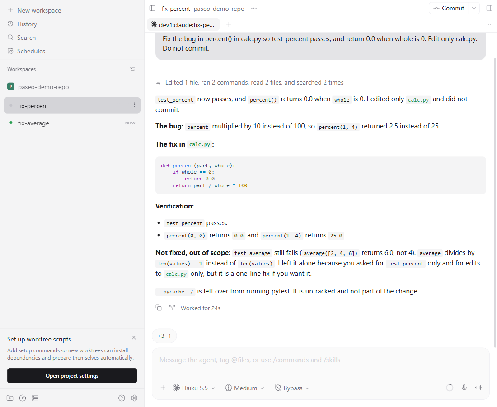
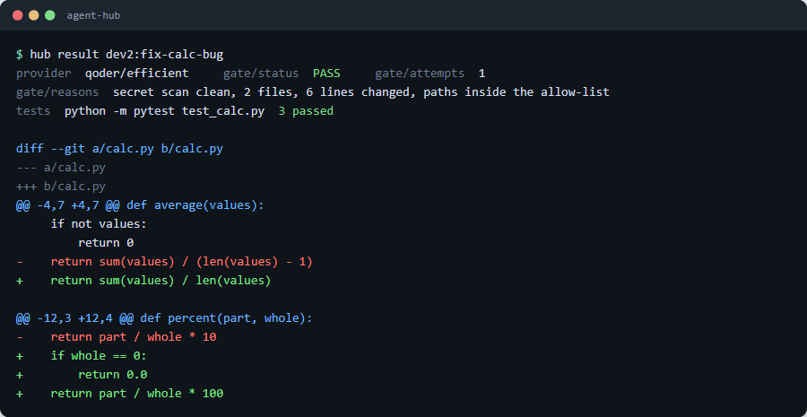
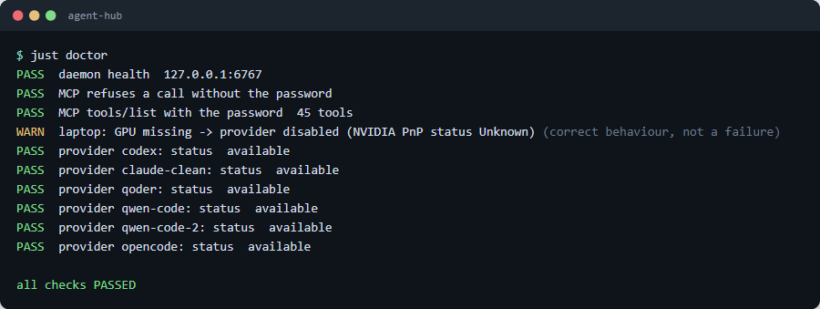
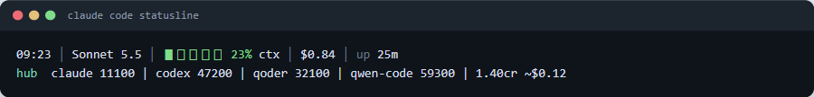
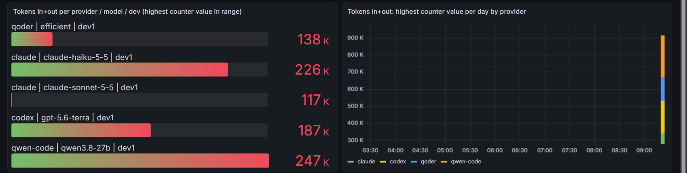

<!--
  AUDIENCE - answer this before filling the README, then delete this comment:
  Who will read this README, and what do they need to know first?
    - future you / a portfolio viewer -> what it does, the stack, how to run it, what you learned
    - teammates / new hires           -> setup, architecture, runbooks, who owns what
    - strangers (open source)         -> install, usage, contributing, licence
  Write for that reader and drop the sections they do not need (/ground-project resolves it).
  Adapted from claude-code-templates cli-tool/components/skills/productivity/crafting-effective-readmes
  ("Always ask: Who will read this, and what do they need to know?") at 8b1f883, MIT,
  (c) 2025 Daniel (San) Avila.
-->
# Agent Hub

Agent Hub configures and extends the [Paseo](https://github.com/getpaseo/paseo) agent daemon so that any AI client (Claude Code, Codex, Qoder, OpenCode, Qwen Code) can hand a task to any agent provider (Codex, Qoder, Claude, Qwen Code, an office SGLang server, a laptop llama.cpp server) and get a verdict plus a diff back. It adds provider config templates, a gate plugin (secret scan, diff-size and path check, two-failure return), a usage plugin with an OTel/Prometheus/Grafana stack, a routing table, a laptop pre-flight, and install scripts for Windows and Linux.

> **New developer? Start with [`.docs/tldr.md`](.docs/tldr.md)** — every doc summarised on one
> page. The full guide lives in [`.docs/`](.docs/README.md).

| Paseo web UI: agents and a task | Paseo web UI: diff of a finished task |
| --- | --- |
|  |  |

| `just doctor` | Statusline `hub` line |
| --- | --- |
|  |  |

| Grafana usage dashboard (demo data) |
| --- |
|  |

Screenshots are real captures from a throwaway demo daemon and demo data (the Paseo web UI, `just doctor`, the statusline script and Grafana); site: https://dxiiren.github.io/agent-hub/.

## Prerequisites

| Tool | Version | Installed by |
| --- | --- | --- |
| PowerShell + winget | Windows 10/11 stock | — (the only true prerequisites) |
| Node.js | >= 20 | `setup.ps1` / `setup.sh` |
| Git | any recent | `setup.ps1` / `setup.sh` |
| just | any recent | `setup.ps1` |
| Claude Code CLI | latest | `setup.ps1` (optional, for AI-assisted dev) |

## Quick start

No `just` yet? Run `powershell -ExecutionPolicy Bypass -File install-just.ps1`, open a new
terminal, then `just install` (it runs `setup.ps1`).

```powershell
# 1. One-time machine setup (idempotent — safe to re-run)
pwsh ./setup.ps1

# 2. Close and reopen PowerShell so PATH updates land

# 3. Install dependencies and validate every config template
just deps && just test
```

There is no dev server: `just test` exiting 0 means every config template parses and holds placeholders only. Linux and macOS use `sh ./setup.sh` (or `just install`) instead of step 1.

## Benchmarks

Interim update: cells marked "running" are still being measured; "pending" means not started. Nothing is estimated.

Measured 5 November 2026 through the installed hub: each task runs in a throwaway worktree and is judged by its own gate (never by the agent's say-so). Set A = 7 easy edits, set B = 10 hard code edits, set C = 3 tasks (log summary, test scaffold that must kill 3 mutants, code review). Latest version of each model is shown; most cells are n=1 or 2, so one task of difference is noise. Full method, per-tier Qoder credits, harness comparison and history are in the [guide](https://dxiiren.github.io/agent-hub/#bench).

| Model | Harness | Set A (7) | Set B (10) | Set C (3) | Median s |
|---|---|---|---|---|---|
| Codex gpt-6.1-terra | Codex | 3/3, running (3 of 7 done) | 10/10 | 2/3 | 67 |
| Codex gpt-6.1-sol | Codex | 3/3, running (3 of 7 done) | 10/10 | 3/3 | 86 |
| Codex gpt-6-luna | Codex | 3/3, running (3 of 7 done) | 8/10 | 3/3 | 73 |
| Codex gpt-6-astra * | Codex | pending | pending | pending | - |
| Claude Sonnet 5.5 | Claude | 3/3, running (3 of 7 done) | 10/10 | 3/3 | 70 |
| Claude Haiku 5.5 | Claude | 3/3, running (3 of 7 done) | 9/10 | 3/3 | 96 |
| Claude Opus 5.5 | Claude | 3/3, running (3 of 7 done) | 10/10 | 2/3 | 70 |
| Qoder Efficient | Qoder | 3/3, running (3 of 7 done) | pending | pending | 65 |
| Qoder Fast | Qoder | 3/3, running (3 of 7 done) | 10/10 | 2/3 | 83 |
| Qoder DeepSeek-Flash | Qoder | 3/3, running (3 of 7 done) | 10/10 | 2/3 | 99 |
| Qoder Qwen3.8-Flash | Qoder | 3/3, running (3 of 7 done) | 8/10 | 2/3 | 186 |
| Qoder GLM-5.3-Flash | Qoder | 3/3, running (3 of 7 done) | 3/10 | 3/3 | 203 |
| Qoder MiniMax-M3.1-Flash | Qoder | 3/3, running (3 of 7 done) | 6/10 | 3/3 | 187 |
| Qoder DeepSeek-V4-Pro | Qoder | 3/3, running (3 of 7 done) | 4/10 | 2/3 | 189 |
| Qoder Qwen3.8-Max | Qoder | 3/3, running (3 of 7 done) | 5/10 | 3/3 | 268 |
| Qoder GLM-5.3 | Qoder | 3/3, running (3 of 7 done) | 9/10 | 3/3 | 189 |
| Qoder Kimi-K3.1-Pro | Qoder | 3/3, running (3 of 7 done) | 9/10 | 3/3 | 147 |
| Qwen3.8-27B (single GPU) | Qwen Code | 7/7 | 7/10 | 2/3 | 115 |
| Qwen3.8-27B-NVFP (2-node cluster) | Qwen Code | 6/7 | 9/10 | 2/3 | 109 |
| Qwen3.5-9B laptop, 32k (default) | Qwen Code | 7/7 | 1/10 | 3/3 | 76 |
| Qwen3.5-9B laptop, 64k (partial) | Qwen Code | 4/5, running (5 of 7 done) | 4/10 | pending | 147 |
| Qwen3.5-9B laptop, 64k (partial) | OpenCode | 1/1, running (1 of 7 done) | 1/10 | pending | 119 |
| Qwen3.5-9B laptop, 32k (partial) | OpenCode | 1/1, running (1 of 7 done) | pending | 1/3 | 60 |

* Benchmark only; not in routing unless the owner approves.

### Qoder tiers (qodercli 1.1.81)

| Qoder tier | Set A (7) | Set B (10) | Set C (3) | Median s | Credit multiplier | Credits per task (measured) |
|---|---|---|---|---|---|---|
| Efficient | 3/3, running (3 of 7 done) | pending | pending | 65 | 0.00x | 0.35 |
| Fast | 3/3, running (3 of 7 done) | 10/10 | 2/3 | 83 | 0.80x | 6.82 |
| DeepSeek-Flash | 3/3, running (3 of 7 done) | 10/10 | 2/3 | 99 | 0.10x | 0.71 |
| Qwen3.8-Flash | 3/3, running (3 of 7 done) | 8/10 | 2/3 | 186 | 0.10x | 0.92 |
| GLM-5.3-Flash | 3/3, running (3 of 7 done) | 3/10 | 3/3 | 203 | 0.10x | 0.68 |
| MiniMax-M3.1-Flash | 3/3, running (3 of 7 done) | 6/10 | 3/3 | 187 | 0.10x | 1.82 |
| DeepSeek-V4-Pro | 3/3, running (3 of 7 done) | 4/10 | 2/3 | 189 | 0.50x | 3.50 |
| Qwen3.8-Max | 3/3, running (3 of 7 done) | 5/10 | 3/3 | 268 | 0.50x | 16.77 |
| GLM-5.3 | 3/3, running (3 of 7 done) | 9/10 | 3/3 | 189 | 0.80x | 9.85 |
| Kimi-K3.1-Pro | 3/3, running (3 of 7 done) | 9/10 | 3/3 | 147 | 1.00x | 8.10 |

Qoder credit multiplier = the "x Credit" label each model carries in the `qodercli` 1.1.81 ACP model list (Efficient 0.00x = free tier). Credits per task = measured mean from the run records. Claude cost per task: Sonnet $0.235, Opus $0.530, Haiku $0.020 (from the set B/C runs); other cells are flat rate or local.

Superseded versions (Codex gpt-6-sol, gpt-5.6 family) are in the guide under History. The hub's own overhead was measured too: after hashing the daemon password at bcrypt cost 4, ten parallel MCP clients drop from a 15.5 s to a 4.7 s median per task (details in the guide).

## Commands

Run `just` with no arguments to list every recipe. The ones you'll use daily:

| Command | What it does |
| --- | --- |
| `just install` | Install the toolchain (runs `setup.ps1` / `setup.sh`) |
| `just deps` | Install the npm dependencies |
| `just test` | Validate every config template (`scripts/check-config.mjs`) |
| `just lint` | Same config check (no code to lint yet) |
| `just build` | Same config check (plugins land per `tasks.md`) |
| `just scan` | Scan tracked files for internal hosts, paths and secrets before any push |
| `just claudex` | Launch Claude Code (Sonnet, all permissions) |
| `just claudeo` / `just claudeh` | Same, on Opus / Haiku |

## Security

Full-access, bypass and yolo modes are used only with `--new-workspace worktree` (a throwaway worktree); `route.mjs` drops them otherwise. The daemon password lives in `<paseo home>/agent-hub-secret` and is never put in the environment agents inherit.

**Latest aliases.** A route entry may name `codex/latest`, `codex/latest-sol|terra|luna`, `claude/latest-opus|sonnet|haiku` `qoder/<tier>@latest`, `qoder/latest-<family>` or `opencode/office@latest` instead of a pinned model. `route.mjs` resolves it at dispatch to the highest version the provider lists (Codex: `~/.codex/models_cache.json`, version-sorted, `astra` never chosen, a family without the newest version falls back to the newest overall for `codex/latest`; Claude and Qoder: `paseo provider models`), cached 10 min. `node plugins/routing/route.mjs --resolve <alias>` prints the mapping now; `just doctor` lists resolved aliases and warns about pinned older models. **Qoder** versions: tiers are matched on their display name, so `qoder/latest-<family>` (e.g. `latest-qwen-max`, `latest-deepseek-pro`, `latest-kimi-pro`) picks the highest version in that family and `qoder/<tier>@latest` moves an older versioned tier up to it (unversioned tiers such as `efficient` just must still be listed). **Office Qwen and the laptop model** are not pinned: `deploy/office/office-agent.mjs` (qwen-code, qwen-code-2) and `laptop-agent.mjs` read the served id from `GET <base>/v1/models` at spawn (cached 10 min; the configured model is only the fallback), and `opencode/office@latest` points the opencode config at the served id. **Tools:** `just doctor` lists every CLI's installed vs latest published version (npm view) and the laptop GGUF with its date; `just update` updates the ones behind, Paseo only with `just update --paseo`. Nothing updates or downloads by itself.

## Troubleshooting

### `just: command not found` right after setup

PATH updates only land in a new shell. Close and reopen PowerShell, or run `powershell -ExecutionPolicy Bypass -File install-just.ps1` first.

### `just test` fails with a config error

`scripts/check-config.mjs` reports the template and the key. Templates must be valid JSON and contain only `<PLACEHOLDER>` values, never real hosts or secrets; fix the file and re-run.

### `just scan` flags a file

The scan blocks internal host names, private IPs, personal paths and secrets. Replace the value with a placeholder such as `<OFFICE_QWEN_URL>`.

More in [`.docs/06-troubleshooting/common-issues.md`](.docs/06-troubleshooting/common-issues.md).

## Project layout

```
agent-hub/
├── config/              JSON templates with <PLACEHOLDERS> (daemon config, MCP clients, routes, claude-clean settings)
├── scripts/             check-config.mjs (validates every template), scan.mjs (internal host/path/secret scan)
├── plugins/             gate and usage plugins (land per specs/001-agent-hub/tasks.md)
├── deploy/
│   ├── laptop/          laptop pre-flight and llama.cpp server setup
│   ├── usage/           OTel / Prometheus / Grafana stack
│   └── server/          server-side install
├── ci/                  CI workflow files
├── specs/001-agent-hub/ spec-kit: spec.md, plan.md, tasks.md
├── .specify/            spec-kit templates and scripts
├── .docs/               developer docs (start at tldr.md)
├── .claude/             Claude Code kit (skills, agents, hooks, settings)
├── justfile             daily recipes (Windows PowerShell and Linux sh)
├── setup.ps1 / setup.sh toolchain install (Windows / Linux)
├── package.json         Node >=20, ESM; test/lint/build/scan scripts
├── LICENSE / NOTICE     Apache-2.0; NOTICE credits Paseo
└── README.md / CLAUDE.md
```

## License

Apache-2.0, see [LICENSE](LICENSE). [NOTICE](NOTICE) credits Paseo, the agent daemon this repo configures and extends.
