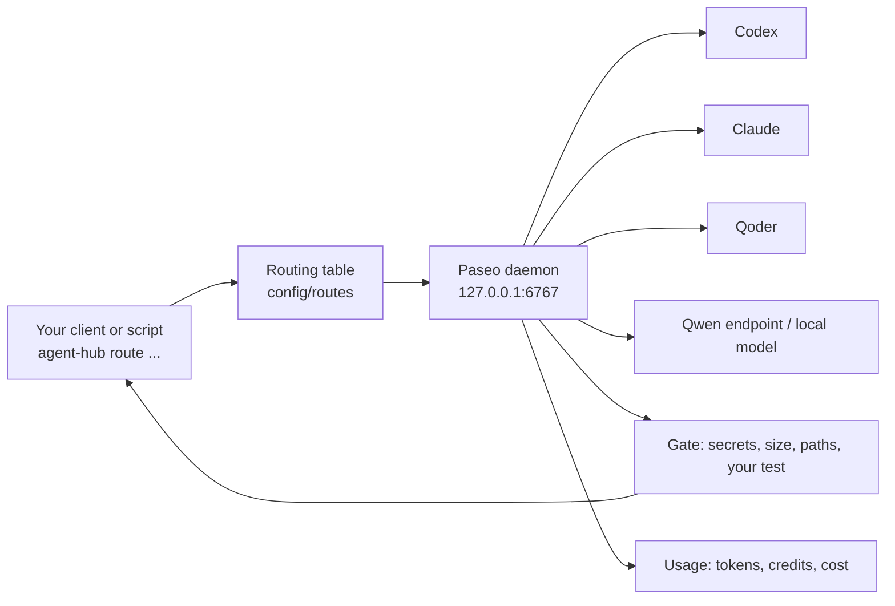
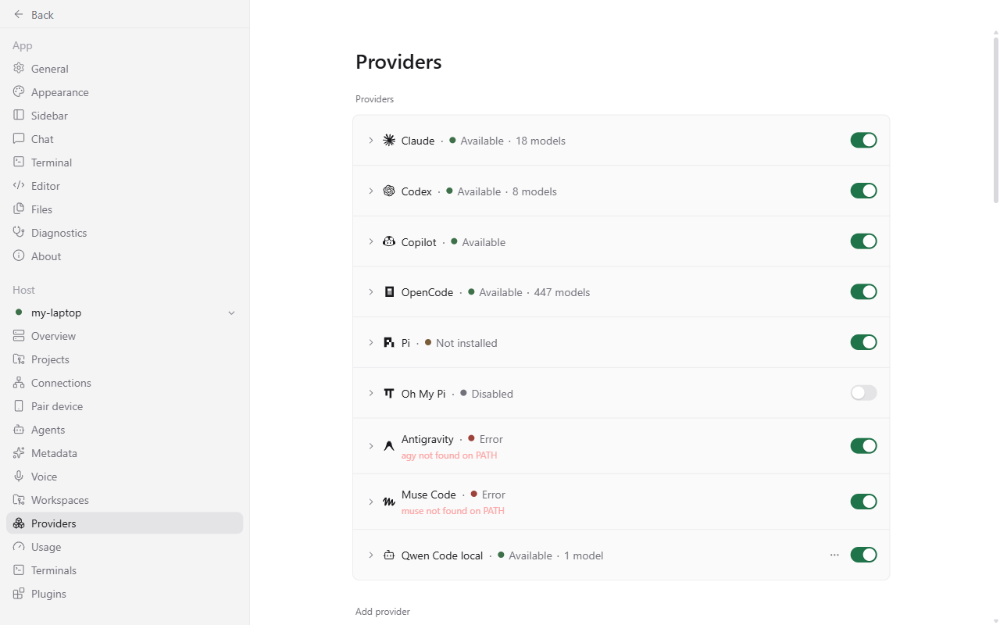
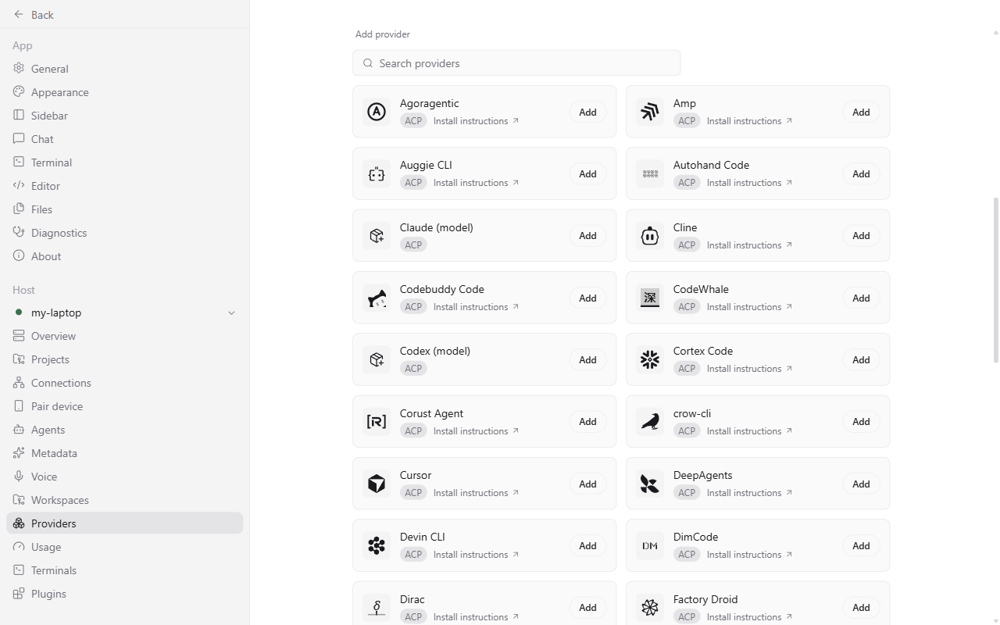
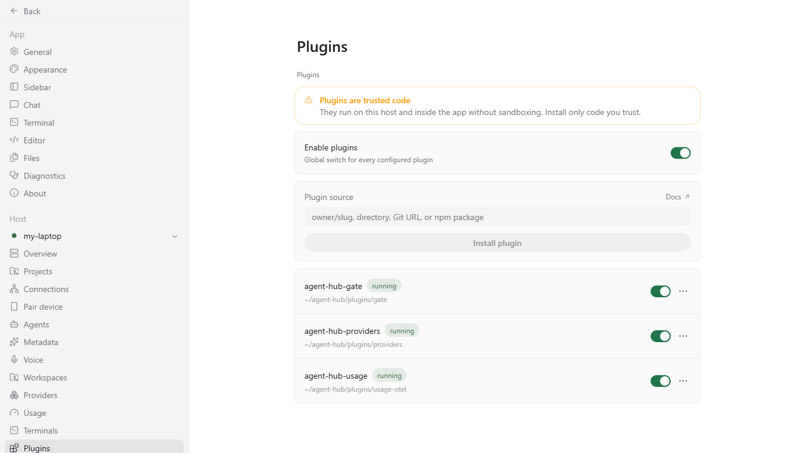

# Agent Hub

Agent Hub lets any AI client (Claude Code, Codex, Qoder, OpenCode, Qwen Code) hand a task to any agent provider (Codex, Claude, Qoder, a Qwen model on your own server, a local llama.cpp model) and get an answer or a diff back. It is a set of config templates, plugins and scripts on top of the [Paseo](https://github.com/getpaseo/paseo) agent daemon: a **routing table** picks the provider, a **gate** checks every edit (secret scan, diff size, forbidden paths, your test command), and a **usage** view shows tokens, credits and cost. There is no server of its own: you install it, start the daemon, and use the `agent-hub` command or the web page.



New here? Read the [quick start](#quick-start-5-steps), then [`.docs/tldr.md`](.docs/tldr.md). AI agent working on or with this repo? Read [`AGENTS.md`](AGENTS.md).

## Prerequisites

| Tool | Notes |
| --- | --- |
| Git, Node.js 20 or newer | installed for you by `setup.ps1` (Windows) / `setup.sh` (macOS, Linux) |
| `just` | installed by `setup.ps1`; on a PC without it run `powershell -ExecutionPolicy Bypass -File install-just.ps1` and open a new terminal |
| gitleaks 8.30.1 (exactly) | **you install it**, the gate refuses to pass without it: `winget install Gitleaks.Gitleaks --version 8.30.1`, or `brew install gitleaks`, or unzip the release into `tools/gitleaks/` (or set `AGENT_HUB_GITLEAKS` to the binary). `agent-hub doctor` FAILS until it is found |
| At least one agent CLI, signed in | `codex`, `claude`, `qodercli`, `qwen` or `opencode`. A provider appears only for a CLI that is installed |

## Quick start (5 steps)

1. **Install** (once, safe to re-run). Windows: `just install` (or `powershell -ExecutionPolicy Bypass -File setup.ps1`). macOS/Linux: `sh ./setup.sh`. Open a **new** terminal afterwards so PATH updates land. Then `npm install`.
2. **Start the daemon:** `just up`. Check it: `agent-hub doctor` (see [Troubleshooting](#troubleshooting) for FAIL vs WARN).
3. **Open the UI:** `http://127.0.0.1:6767/` > Direct connection, host `127.0.0.1`, port `6767`, password = the content of `~/.paseo/agent-hub-secret` (Windows: `%USERPROFILE%\.paseo\agent-hub-secret`). Never paste this password anywhere else.
4. **Add a provider** (a fresh install has none beyond your installed CLIs): in the UI go to **Settings > Providers > Add provider**, search `qwen`, press Add, give it a name, paste the base URL of your OpenAI-compatible server (`http://host:8000/v1`), press **Load models**, pick one, tick the task types (`summarise`, `code-edit`), **Add provider**. Or in the shell:
   `agent-hub provider add my-qwen --kind qwen-code --url http://127.0.0.1:8000/v1 --model <model id> --routes summarise,code-edit`
   then restart once: `just down && just up`.
5. **Route a task:** `agent-hub route summarise "Summarise README.md in 5 bullets" --cwd .`
   You get one JSON line: `used` (which provider), `status`, `answer`. No Qwen endpoint yet? Try an edit on a throwaway git repo with Codex or Claude:
   `agent-hub route code-edit "Create hello.txt containing hi" --cwd /path/to/repo --new-workspace worktree --gate "test -f hello.txt"`
   (about 2 minutes). `summarise` and `review` never run on a provider without an enforced read guard, so with only Codex/Claude installed they answer with a message telling you to add a Qwen provider.

Read usage afterwards: `agent-hub usage --all`, or Settings > Usage in the UI.

## Where things live

| What | Where |
| --- | --- |
| Paseo home (config, secret, logs, run files, usage cache) | `~/.paseo` (override: `PASEO_HOME`) |
| Daemon password | `<paseo home>/agent-hub-secret` (never commit or print it) |
| Daemon log | `<paseo home>/daemon.log` |
| Your providers and routes | `config/hub.local.json`, `config/routes/routes.local.json` (git-ignored; templates are `*.template.json`, never edited by commands) |
| Custom provider kinds | `config/provider-kinds.local.json` |
| Plugins (gate, usage, providers form) | `plugins/` |
| Usage stack (Grafana :3000, Prometheus :9090, collector :4318) | `deploy/usage/`, data in `%LOCALAPPDATA%\agent-hub\usage` |
| Per-task usage records | `<paseo home>/usage/` |

## UI tour

| Screen | What you do there |
| --- | --- |
|  | **Settings > Providers.** Every provider with a status dot: Available, Error (the line below says why, usually "not found on PATH"), Disabled. Toggle a provider off here. |
|  | **Add provider.** Search the catalog; the Agent Hub kinds (qwen, opencode, local model, one more model of Codex/Claude/Qoder) open a form with a **model picker** filled live from the endpoint or the CLI. If the kinds are missing, open **Plugins > agent-hub-providers** instead. |
|  | **Plugins.** `agent-hub-gate`, `agent-hub-providers` and `agent-hub-usage` must show `running`. If not: `just plugins`, then `just down && just up`. |
|  | `agent-hub doctor` output. |
|  | **Usage:** Settings > Usage shows plan percentages and one card per self-hosted endpoint (up/down, tokens today); Grafana (`http://127.0.0.1:3000`) shows tokens per provider and per day. |

## Routing & slots (models, slots and chain order per provider)

Settings > Plugins > agent-hub-providers > **Routing & slots** (also in the command palette), and the same on the command line. Both use one backend, `scripts/routes.mjs`, and write `config/routes/routes.local.json`, the file `route.mjs` reads. Writes take the same lock and atomic write as `provider add`, never touch a template, and every save can be undone byte for byte.

- **Per provider:** on/off (Paseo's own enabled flag; the page changes it live through the daemon, the CLI writes the Paseo config and tells you to restart), which of its models the hub may use (one switch per model from the live list; none restricted = all allowed), parallel slots (1 to 64), and whether it may run read-only tasks (shown, not editable).
- **Per task type** (`code-edit`, `code-edit-easy`, `summarise`, `test-scaffold`, `review`): chain order with Up / Down / Off and an add list. Earlier entries are tried first.
- **A model that is not allowed is never used:** the next entry is tried, and an explicit `--provider P/M` cannot bypass it. A chain entry with no model (an endpoint provider's own model) is not restricted.
- **Totals:** the page shows configured slots and an "effective now" figure (today the slots of enabled providers; `effectiveBudget()` in `plugins/routing/budget.mjs` is the one place a laptop-based budget plugs in).

```
agent-hub routes show [--json] | models <provider> | undo
agent-hub routes set <provider> [--slots N] [--models id,id|all] [--enabled true|false]
agent-hub routes chain <type> <entry,entry,...>
agent-hub routes move <type> <entry> up|down|off
```

Bad input is refused with every problem listed and nothing written. Undo is refused when the routes file changed after the save you would undo.

## Command cheat-sheet

Run `agent-hub --help` or `agent-hub <command> --help` (help never runs the command).

| Goal | Command |
| --- | --- |
| Route a task | `agent-hub route <code-edit\|code-edit-easy\|test-scaffold\|summarise\|review> "<prompt>" --cwd . [--gate "npm test"] [--new-workspace worktree] [--provider P/M]` |
| Edit tasks | use `--new-workspace worktree` (throwaway copy) and a real `--gate`; the gate must pass or `status` is `gate-failed` |
| Agent asked a question (`status: "asking"`, exit 3) | `agent-hub reply <agentId> "<answer>"` (never put a secret in it; up to 3 questions per task) |
| Routing & slots | `agent-hub routes show \| set <provider> --slots N --models a,b \| chain <type> a,b \| move <type> <entry> up\|down\|off \| undo` |
| Providers | `agent-hub provider kinds \| list \| models --kind K --url U \| add NAME --kind K ... \| edit NAME --slots 4 \| remove NAME` |
| Usage | `agent-hub usage --all`, `agent-hub usage --session <id> --json` (--session defaults to `AGENT_HUB_SESSION`, else `CLAUDE_CODE_SESSION_ID`, also for `route`) |
| Health | `agent-hub doctor` (add `--deep` to run one tiny task per provider; uses tokens) |
| Tidy up | `agent-hub cleanup --older-than 30m --dry-run`, then without `--dry-run` |
| Daemon | `just up`, `just down`, `just status`, `just plugins` |
| Update CLIs | `just update` (Paseo stays pinned unless `just update --paseo`) |
| Develop on the hub | `npm test`, `npm run scan` (see [`AGENTS.md`](AGENTS.md)) |

Route result fields: `used`, `agentId`, `status` (`completed`, `asking`, `gate-failed`, `failed-readonly-changed`, `permission`, `rejected`, `error`), `gate` (`status`, `reasons`), `trace` (what each provider did or why it was skipped), `answer`. Exit code: 0 completed, 3 asking, 1 failed, 2 bad input.

## Troubleshooting

- **`just` or `agent-hub` not found after setup:** open a new terminal.
- **Hub down or hangs when the machine is low on RAM:** `just status`, then `just down && just up`. A start can take 10 to 20 s when many tasks start together; `route` retries by itself. Free RAM under 3 GB makes the local-model provider refuse.
- **UI says 401 or asks for a password:** use the content of `<paseo home>/agent-hub-secret`. The hosted app.paseo.sh cannot connect; use the local page.
- **A provider shows Error:** read the line under it. "not found on PATH" = install that CLI. After adding a provider run `just down && just up`.
- **Model list is empty:** the endpoint must answer `GET <url>/models`; test it with `curl <url>/models`. `agent-hub provider models --kind qwen-code --url <url>` shows what the hub sees.
- **`LAPTOP-REFUSED` (local model refused):** the NVIDIA GPU is not visible, is already used by another process, or free RAM is under 3 GB. The router moves on to the next provider.
- **`route` printed `no provider took this task`:** read `trace`. `summarise`/`review` need a Qwen-kind provider or claude-clean; `code-edit` needs Codex or Claude installed and signed in.
- **`status: gate-failed`:** `gate.reasons` says why: secret found in the diff, too many lines, a forbidden path (`.env`, `.github/`, `*.pem`), or your `--gate` command failed twice. Fix the cause; do not weaken the gate.
- **`status: permission`:** an edit task ran outside `--new-workspace worktree`; add it.
- **`doctor` FAIL vs WARN:** FAIL = broken (exit 1), fix it first (gitleaks missing, daemon down, usage stack down). WARN, NOTE and INFO are advice (a CLI is behind, qodercli is not the pinned 1.1.81).
- **`REFUSED: PASEO_HOME ... would overwrite this clone's config`:** you pointed a command at a temp home. Add `AGENT_HUB_NO_LOCAL=1` so provider files stay inside that home.
- **`npm test` says PASSED WITH SKIPS:** gitleaks was not found; install it (above) for the full suite.
- More: [`.docs/06-troubleshooting/common-issues.md`](.docs/06-troubleshooting/common-issues.md).

## More documentation

- [`.docs/tldr.md`](.docs/tldr.md): every doc in one page.
- [Providers, accounts, security, latest aliases (full reference)](.docs/05-reference/providers-security-reference.md)
- [Benchmarks, concurrency, change notes](.docs/05-reference/benchmarks-and-changes.md)
- [`AGENTS.md`](AGENTS.md): for AI agents working on or with this repo.

## Layout

```
agent-hub/
├── config/    templates (*.template.json) and your git-ignored *.local.json
├── scripts/   hub.mjs (install core, doctor, provider), help.mjs, scan.mjs, check-config.mjs
├── plugins/   gate, routing (agent-hub route), usage-otel, providers
├── deploy/    service (daemon), usage stack, laptop model, office launchers
├── .docs/     developer docs
└── justfile, setup.ps1 / setup.sh, package.json, LICENSE, NOTICE
```

## License

Apache-2.0, see [LICENSE](LICENSE). [NOTICE](NOTICE) credits Paseo.
