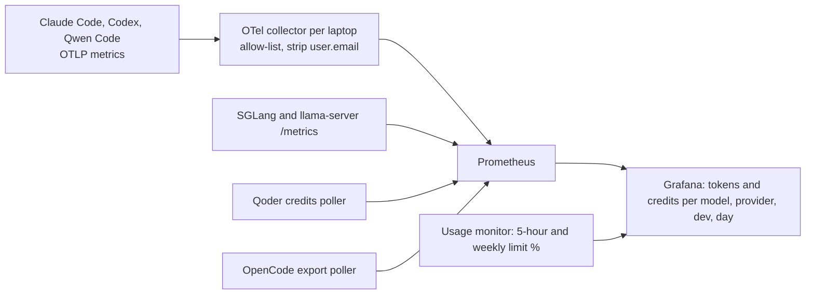

# Plan 001: agent-hub

Spec: [spec.md](spec.md). Sanitised: placeholders only.

## 1. Architecture

```mermaid
flowchart LR
  subgraph clients["Any AI client"]
    A1["Claude Code"]
    A2["Codex"]
    A3["Qoder"]
    A4["OpenCode"]
    A5["Qwen Code"]
  end
  clients --> door["Daemon MCP /mcp/agents<br/>CLI fallback: run, wait, logs --json"]
  door --> route["routing table<br/>caller override, next entry if busy or down"]
  route --> prov
  subgraph prov["Agent providers"]
    P1["Codex"]
    P2["Claude (clean config)"]
    P3["Qoder: qodercli --acp"]
    P4["Qwen Code on office SGLang"]
    P5["OpenCode"]
    P6["Laptop llama-server + Qwen Code"]
  end
  prov --> wt["throwaway git worktree"]
  wt --> gate["gate plugin: caller gate or repo default,<br/>secret scan, diff-size and path check"]
  gate -->|"verdict and diff stat in labels"| clients
  gate -->|"pass"| pr["PR step: tea pr create"]
```





## 2. Providers

| Provider | How it is wired | Notes |
|---|---|---|
| Codex | built in | model chosen per task type |
| Claude | built in | own `CLAUDE_CONFIG_DIR` with no extra MCP servers (a default Claude agent costs about 2 GB for its process tree) |
| Qoder | custom provider `extends: acp`, `qodercli --acp` | upstream resume shows an empty history; run, wait and diff work |
| Qwen Code | custom ACP provider, `--auth-type openai`, base URL `<OFFICE_QWEN_URL>` | dummy key, no secret file |
| OpenCode | built in | `OPENCODE_DISABLE_MODELS_FETCH=1`, own `opencode.json`, telemetry and external skills off, empty `XDG_CONFIG_HOME`; 64k context on the laptop |
| Laptop model | `llama-server`, Qwen3.5-9B UD-Q4_K_XL, q8_0 KV, 32k | pre-flight: GPU visible, no heavy-run lock, RAM >= 3 GB |
| Office model | SGLang at `<OFFICE_QWEN_URL>` | no admin endpoint is ever called |

## 3. Routing

A small `routes` file maps task type to an ordered provider list. The caller overrides per task (`create_agent provider:"<profile>/<model>"`). Without a core patch the shape is provider profiles in the daemon `config.json`; the fallback is a routing plugin that creates a replacement agent after a failed outcome. `agent.create.before` carries no labels, so the task type is encoded in the profile id or title. Starting values (proposals, replaced by a bench): code-edit goes to the office model then Codex; summarise to the office model then the laptop; image to the office image model.

## 4. Gate and verdict

Plugin on `agent.turn.after`. On a completed turn: run the gate command in the worktree, run the secret scan and the `git diff --numstat` path and size rules; on failure send the failure summary to the agent; after the second failure set labels `gate=failed` and `gate_report=...` and stop. It acts on any agent regardless of which client created it.

## 5. Forge

`create_workspace mode=checkout-branch` works. PR checkout is unsupported upstream for Gitea and Forgejo, so the PR head is reached by branch name. The gate plugin pushes and runs `tea pr create`. Each developer needs `tea login add` against `<GITEA_URL>`. If PR-status polling floods the proxy rate limit (upstream issue), switch it off for headless agents.

## 6. Usage

The collector per laptop keeps an allow-list only and strips `user.email`. Claude: leave prompt, tool-detail and raw-body logging unset. Codex: never set `log_user_prompt`, set `metrics_exporter` explicitly. Qwen Code: metrics only, `logPrompts=false`. Per-task numbers come from a usage plugin on `agent.turn.after` plus the daemon's usage-source seam for limit windows. Dashboard: start from a community Grafana LLM-usage dashboard, add provider and developer variables, SGLang and llama.cpp panels and a slot-use panel; show the token-type split, never one summed number. The status line reads a local per-session feed (spec D14).

## 7. Where it runs

Per-developer daemon on each laptop, bound to loopback. A shared server runs one container per developer behind a login proxy (about 0.25-0.3 GB per daemon or running agent, so RAM grows with every developer and agent). Service mode: Task Scheduler on Windows, systemd on Linux, wrapping `paseo daemon start --foreground`. Install pins exact versions.

## 8. Security

Loopback bind; remote only with a password (without one `/mcp/agents` answers anyone who can reach the port). Full-access mode only in a throwaway worktree. The office server stays open by owner decision, so our tools never call its admin endpoints. Web UI off by default.

## 9. Repo layout

```
agent-hub/
  config/            templates with <PLACEHOLDERS>; real values in *.local.* (git-ignored)
  plugins/gate       gate runner, secret scan, diff rules, PR step
  plugins/usage-otel per-task usage numbers
  plugins/routing    routing table and fallback
  deploy/laptop      laptop provider and pre-flight
  deploy/usage       collector, Prometheus, Grafana compose
  deploy/server      container per developer, login proxy
  ci/                rebase job and 5x5 matrix
  specs/001-agent-hub/
  setup.ps1 setup.sh install.ps1 install.sh justfile
```

## 10. Risks

The daemon plugin hook API is new; every release is tested and the plugin range pinned. The gate is a follow-up, not a veto. Laptop RAM and GPU contention: the pre-flight refuses rather than degrades. Upstream drift: the rebase job runs the 5x5 matrix per release.
